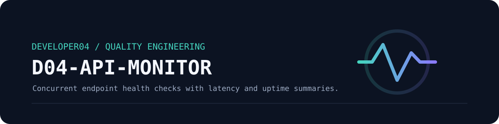

<p align="center"></p>

# d04-api-monitor

Concurrent endpoint health checks with latency and uptime summaries.

## Features
- Node.js 20+ ES modules
- Deterministic result objects for automation and dashboards
- Configurable behavior with conservative defaults
- No runtime dependencies

## Install
```bash
npm install
```

## Quick start
```js
import { runChecks, MonitorHistory } from "d04-api-monitor";
const report = await runChecks([{ url: "https://example.com/health" }, { url: "https://status.example.com" }], { concurrency: 3, timeoutMs: 4000 });\nconst history = new MonitorHistory();\nfor (const result of report.results) history.add(result);\nconsole.log(report, history.summary());
```

## Development
```bash
npm test
```

## License
MIT
